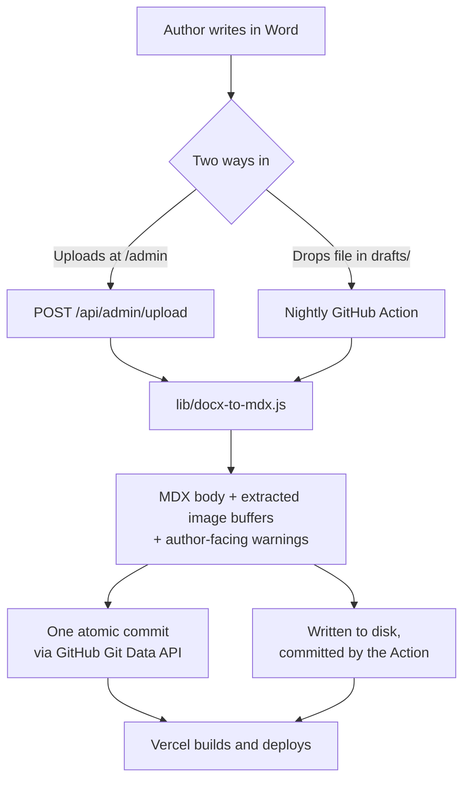

# Saffron Isle

A publishing pipeline that turns Word documents into a deployed static site.

[saffronisle.com](https://saffronisle.com) is a blog for Indians moving to, living in, or building a
life in Ireland. The interesting part isn't the blog — it's what sits behind it.

## The problem

The person who writes for this site is not an engineer. She writes in Microsoft Word, with pictures
placed inline, and she should never have to see a terminal, a git command, or a markdown file.

The site is statically generated from MDX in `content/articles/`, deployed from `main`. So something
has to sit between a `.docx` on a laptop and a commit on a branch — and it has to be reliable enough
that a failure never leaves the site in a broken state, because there is nobody on the other end who
could diagnose one.

## How it works



Both routes share one converter and one frontmatter builder. Neither performs side effects inside the
conversion — `convertDocx()` returns data, and the caller decides whether it lands in a commit or on
disk.

## The parts worth reading

### Images have to bracket the conversion, not join it

`htmlToMarkdown()` is a chain of regex replacements over mammoth's HTML output. The obvious way to
support embedded images is another rule in the chain. That breaks in three separate ways:

1. mammoth emits `<p></p>` on a single line, and the `<p>` rule is non-greedy and not
   `s`-flagged — injecting `\n\n` mid-chain glues neighbouring paragraphs together.
2. The `<a href>` rule runs before `<p>`, so a hyperlinked image becomes `[<ArticleImage/>](url)`.
3. The catch-all `/<[^>]+>/g` at the end eats whatever survived.

So every `` is swapped for an inert, newline-free sentinel *before* the chain runs, and expanded
back into standalone JSX *after* it finishes. The chain itself never learns images exist.

See [`lib/docx-to-mdx.js`](lib/docx-to-mdx.js) — the `CONVERSION NOTES` block at the bottom.

### MDX silently deletes the attributes you'd reach for first

`next-mdx-remote` v6 runs `removeJavaScriptExpressions` over every document by default. It strips all
`{...}` attribute values — so an image emitted as `src={"/images/…"}` renders with **no src, no
dimensions and no alt**, and throws nothing while doing it.

Literal string attributes are the only form that survives. Alt text is therefore HTML-escaped on the
way in and decoded back by MDX, and `ArticleImage` coerces the numeric strings back to numbers. The
escaping is not cosmetic: a straight `"` in alt text would otherwise close the attribute early.

### Publishing is one commit, not N+2

The GitHub Contents API writes a single file per call. Publishing an article with three images meant
five sequential commits — five Vercel deploys — and a real window where the article was live on a
deploy whose image pushes hadn't landed yet.

[`commitFiles()`](lib/github-repo.ts) uses the Git Data API instead: upload blobs, build one
tree, create one commit, then move the ref. One deploy, and no partial state. A `422` on the ref
update means someone published concurrently, and says so in words the author can act on.

### Four bugs that were all the same bug

Duplicated logic caused every one of them. Each fix was consolidation, not a patch:

| Shared module | What was duplicated | What it cost |
|---|---|---|
| [`lib/docx-to-mdx.js`](lib/docx-to-mdx.js) | The whole conversion | Web and cron paths could produce different MDX from one document |
| [`lib/frontmatter.js`](lib/frontmatter.js) | Frontmatter construction | Author input interpolated raw into YAML — one straight quote produced an unparseable article, and **failed the entire build** |
| [`lib/category-slugs.js`](lib/category-slugs.js) | The category list | A slug the writer accepted but the reader rejected meant a successful publish followed by a dead deploy, with nothing connecting the two |
| [`lib/toc.ts`](lib/toc.ts) | The heading slug algorithm | Three copies, one drifted: `children.join('')` stringified React elements, so every formatted heading rendered `id="object-object"` — a whole article's contents list linking nowhere, and ~20 elements sharing one id |

The third is the one worth dwelling on. `lib/articles.ts` throws on an unknown category and has no
per-file recovery, so a disagreement between two copies of a list doesn't degrade — it takes the site
down, one publish later, in a way the author has no way to attribute to what they just did.

### The password guards a write-scoped token, so it is not just a password

`/api/admin/upload` holds a GitHub PAT that can commit to `main`. Whatever sits in front of it is the
only thing between the open internet and this repository — so a shared password compared with `===`,
resent on every request, guessable as fast as the network allows, was the highest-risk surface in the
project. [`lib/admin-auth.js`](lib/admin-auth.js) replaces it. Three decisions in it are worth the
detour:

**Both sides are hashed before the constant-time compare.** The obvious implementation passes the two
strings straight to `crypto.timingSafeEqual`, which throws on a length mismatch — and catching that
throw leaks the password's length to anyone willing to submit strings of increasing size. SHA-256
digests are always 32 bytes, so every wrong password takes the same branch in the same time,
regardless of what was submitted.

**The session is signed, not stored.** This deploys to serverless functions with no shared memory and
no database, so a session table would not survive between requests. Instead the cookie holds
`<expiry>.<nonce>.<hmac>`, and the expiry lives *inside* the signed payload — editing the cookie to
extend it invalidates the signature. Verification checks the signature before the expiry, so a forged
token and a genuinely expired one are indistinguishable from outside.

**The signing key derives from the password.** A consequence rather than a feature: changing
`ADMIN_PASSWORD` changes the key, which invalidates every outstanding session. That is exactly the
behaviour a password change should have, and it costs no revocation machinery. `ADMIN_SESSION_SECRET`
decouples the two if sessions should survive a rotation.

Rate limiting is five failures per address inside fifteen minutes, then a fifteen-minute lockout
returned as `429` with `Retry-After`. The counter is in-process, so it is per warm instance rather
than global — stated as a limitation below, because it is one.

The password now travels exactly once. Slug lookups and uploads carry no credential at all, and the
upload path checks the session *before* reading the multipart body, so an unauthenticated request
cannot make the server buffer four megabytes of anything.

### Errors are written for the person who hit them

The author cannot read a stack trace and cannot fix the code. So a picture Word saved as EMF produces:

> 1 picture couldn't be used — Word saved it in a format browsers can't show (this happens with charts
> and shapes). In Word: copy the picture, then Paste Special → Picture (PNG), and re-upload.

Oversized documents name the actual megabyte count and the exact Word menu path. Missing alt text
explains who it affects. Every warning names a next action.

## Testing

```bash
npm test
```

107 tests, no checked-in binary fixtures.

[`test/helpers/docx.js`](test/helpers/docx.js) builds real OOXML packages and real PNG bytes in memory,
so mammoth and `image-size` run their genuine parsers rather than stubs. A test declares the document
it needs inline:

```js
const buffer = await buildDocx([
  { text: 'Intro.' },
  { image: photo('Sponsor logo'), href: 'https://example.com' },
  { image: photo('Inside a bullet'), list: true },
])
```

That covers the awkward cases directly: hyperlinked images, images inside list items, unsupported
formats, undecodable bytes, sub-32px Word spacer artifacts, and numbering continuity across skipped
images. The frontmatter tests round-trip through `gray-matter` rather than asserting on generated
text — a string that merely looks escaped proves nothing.

CI ([`.github/workflows/ci.yml`](.github/workflows/ci.yml)) runs typecheck → lint → build → test on
every push and PR to `main`.

## Known limitations

Stated plainly, because they're deliberate trade-offs rather than oversights:

- **`htmlToMarkdown` is a regex chain, not a parser.** It handles what Word actually emits for this
  author's documents. **Tables are not supported at all** — a table in a `.docx` will not survive.
- **Admin auth is still a single shared password** — one secret, no accounts, no second factor. The
  handling around it is hardened (above), but the credential itself is as strong as the password
  chosen for it.
- **Rate limiting is per serverless instance, not global.** The counter lives in process memory, so
  an attacker spread across many warm instances gets more attempts than the stated five. It converts
  unlimited online guessing into a handful of tries per instance without adding a datastore; a shared
  store is the upgrade if it ever needs to be exact.
- **One unparseable article still fails the whole build.** The likeliest causes are fixed, but the
  amplifier remains. Failing loudly at build time is arguably correct — it just hasn't been decided
  deliberately yet.
- **Tests cover the conversion, frontmatter, scheduling and auth layers only.** The auth *module* is
  covered in depth; the route wiring around it, and the components, are not.

## Stack

Next.js 16 (App Router, React 19) · TypeScript · Tailwind CSS v3 · MDX via `next-mdx-remote/rsc` ·
`mammoth` for `.docx` · Vitest · deployed on Vercel.


## Development

```bash
npm install
cp .env.local.example .env.local
npm run dev
```

Open [http://localhost:3000](http://localhost:3000).

| Script | What it does |
|---|---|
| `npm run dev` | Development server — use this while coding |
| `npm test` | Vitest, single run |
| `npm run test:watch` | Vitest in watch mode |
| `npm run typecheck` | `tsc --noEmit` |
| `npm run lint` | `eslint .` |
| `npm run build` | Production build |
| `npm run drafts` | Convert `drafts/*.docx` to MDX locally |
| `npm run clean` | Remove `.next` |

If you see `MODULE_NOT_FOUND` or `vendor-chunks/next.js` errors, `.next` is stale:

```bash
npm run clean
npm run dev
```

`npm start` runs the production server and requires `npm run build` first.

## Environment variables

| Variable | Description |
|---|---|
| `NEXT_PUBLIC_SITE_URL` | Canonical site URL (e.g. `https://saffronisle.com`) |
| `ADMIN_PASSWORD` | Password for the `/admin` publishing page. Changing it signs out every open session |
| `ADMIN_SESSION_SECRET` | *Optional.* Signing key for session cookies. Set it to keep sessions alive across an `ADMIN_PASSWORD` change |
| `GITHUB_TOKEN` | GitHub PAT with `contents: write` — `/admin` commits articles through it |
| `GITHUB_REPO` | Target repo, e.g. `naveennraja/SaffronIsle` |
| `GITHUB_BRANCH` | Branch to commit to (defaults to `main`) |
| `NEWSLETTER_API_KEY` | Brevo or Mailchimp API key |
| `NEWSLETTER_LIST_ID` | List ID from your provider |
| `NEWSLETTER_PROVIDER` | `brevo` (default) or `mailchimp` |

`.env.local` is git-ignored and applies to local dev only. `/admin` runs server-side in production, so
`ADMIN_PASSWORD`, `GITHUB_TOKEN` and `GITHUB_REPO` must **also** be set in the Vercel project's
environment variables, or publishing fails at runtime.

Newsletter signup is switched off in code (`NEWSLETTER_ENABLED` in
[`lib/site-config.ts`](lib/site-config.ts)) until a provider is connected. With no API key the form
previously told visitors "You are subscribed!" while discarding the address — showing it in that state
collects nothing and misleads the people most worth keeping.

## Adding articles

Either upload a `.docx` at `/admin`, or drop `category__slug.docx` into `drafts/` and let the nightly
Action convert it. To write MDX directly, create `content/articles/[category]/your-slug.mdx` with the
frontmatter fields listed in `REQUIRED_FIELDS` in [`lib/articles.ts`](lib/articles.ts).

---

Site content is written by **Nethra Bhaskar**. The pipeline, site and infrastructure are by
**Naveen N Raja**.
